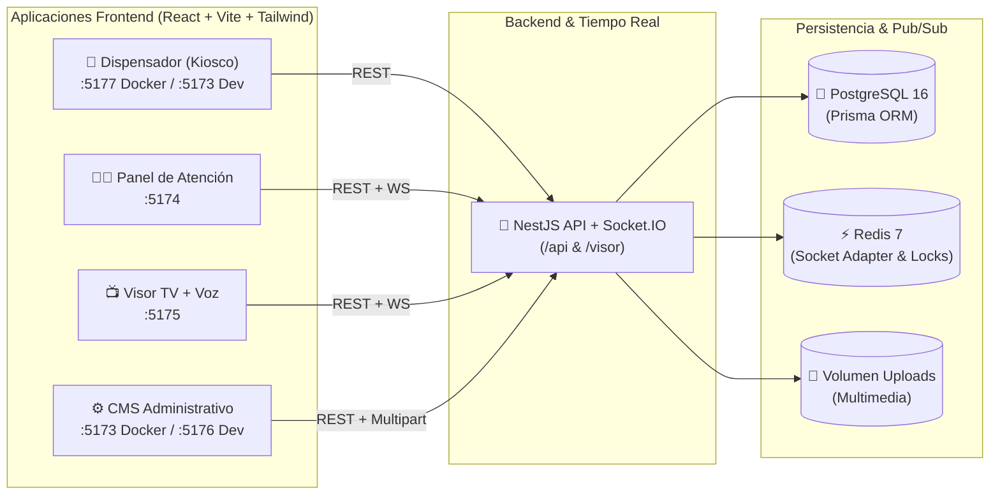

# 🏥 Digiturno — Sistema de Gestión de Turnos Multi-Sede en Tiempo Real


**Digiturno** es una plataforma integral de gestión de filas y atención al usuario pensada para clínicas, centros médicos y entidades con múltiples sedes. Cuenta con arquitectura **multi-tenant por sede**, sincronización en tiempo real mediante **WebSockets (Socket.IO + Redis Adapter)**, síntesis de voz (**Web Speech API**) en pantallas de sala de espera, reproducción de listas multimedia y despliegue contenerizado de extremo a extremo.

---

## ✨ Características Principales

- **🏢 Arquitectura Multi-Sede (Multi-Tenant):** Aislamiento lógico por sede. El rol `admin_central` administra toda la red de sedes, mientras que los roles operativos (`profesional`, `dispensador`) operan estrictamente sobre su sede asignada.
- **⚡ Tiempo Real con Socket.IO + Redis:** Emisión instantánea de eventos (`turno:llamado`, `turno:actualizado`, `playlist:actualizada`) hacia todas las salas y visores de una sede usando adaptador pub/sub de Redis (con *fallback* automático a memoria en desarrollo).
- **🔒 Concurrencia e Idempotencia Garantizada:**
  - Prevención de **condiciones de carrera** (`SELECT ... FOR UPDATE SKIP LOCKED`) cuando múltiples profesionales llaman al siguiente turno simultáneamente.
  - Numeración consecutiva atómica por servicio y sede.
  - **Idempotencia** en el tótem dispensador para evitar tickets duplicados por doble toque.
- **🗣️ Visor Inteligente con Voz (TTS) y Cartelería Digital:** Anuncio por voz del nombre del paciente y módulo de atención, timbre sonoro, historial de últimos llamados y reproductor multimedia (imágenes y videos administrables desde el CMS).
- **🛡️ Seguridad y Protección:**
  - Autenticación JWT (`access_token` + `refresh_token`) y control de acceso basado en roles (`RBAC`).
  - **Rate Limiting (`@nestjs/throttler`)** global y estricto en endpoints críticos como `/auth/login` contra ataques de fuerza bruta y DDoS.
  - Enmascaramiento de documentos de identidad en vistas públicas.
  - Validación estricta de DTOs con `class-validator`.

---

## 🏗️ Arquitectura del Sistema

El proyecto está organizado como un **monorepo** compuesto por **1 Backend API/WebSocket** y **4 aplicaciones Frontend SPA** especializadas, cada una empaquetada en contenedores multi-stage con **Nginx**:



### Módulos de la Plataforma

| Módulo | Puerto (Docker) | Puerto (Dev) | Descripción |
| :--- | :---: | :---: | :--- |
| **Backend API** | `5176` | `3000` / `5176` | API REST en NestJS + Gateway Socket.IO (`/visor`), Prisma ORM y servidor de archivos estáticos (`/uploads`). |
| **CMS Admin** | `5173` | `5176` | Panel administrativo: gestión de sedes, salas, servicios, módulos, visores, usuarios, métricas y listas multimedia. |
| **Atención** | `5174` | `5174` | Consola del profesional: selección de módulo, llamado del siguiente turno en cola, re-llamado, iniciar atención, finalizar o marcar ausente. |
| **Visor TV** | `5175` | `5175` | Pantalla pública de sala de espera: tablero de turnos en tiempo real, alerta visual/sonora, lectura por voz (TTS) y carrusel multimedia. |
| **Dispensador** | `5177` | `5173` | Kiosco táctil de autoservicio: flujo guiado por sede → servicio → nombre → documento y generación de ticket. |

---

## 🛠️ Stack Tecnológico

- **Backend:** Node.js 22, NestJS 11, TypeScript 5, Prisma ORM 7, Socket.IO, Redis (`ioredis` + `@socket.io/redis-adapter`), Passport JWT, `bcryptjs`, `@nestjs/throttler`, Multer.
- **Frontend (x4):** React 19, TypeScript, Vite 6, Tailwind CSS, Socket.IO Client, Lucide Icons / Heroicons.
- **Base de Datos & Caché:** PostgreSQL 16, Redis 7 Alpine.
- **Infraestructura:** Docker, Docker Compose, builds Multi-Stage con Nginx para producción.
- **Testing:** Jest, Vitest y Supertest (pruebas de concurrencia, aislamiento multi-sede, idempotencia y reconciliación de visores).

---

## 🚀 Inicio Rápido con Docker (Recomendado)

La forma más rápida de levantar todo el ecosistema (PostgreSQL, Redis, Backend con migraciones automáticas y los 4 Frontends) es mediante **Docker Compose**:

```bash
# 1. Clonar el repositorio
git clone https://github.com/Dilan2119/digiturno.git
cd digiturno

# 2. Construir y levantar todos los contenedores
docker compose up -d --build
```

Al iniciar el contenedor `backend`, se ejecutan automáticamente las migraciones de Prisma (`prisma migrate deploy`). Para cargar los datos de demostración (semilla) por primera vez:

```bash
docker exec -it digiturno-backend npx ts-node prisma/seed.ts
```

### Accesos en Modo Docker
- **CMS Administrativo:** http://localhost:5173
- **Panel de Atención:** http://localhost:5174
- **Visor de Turnos (TV):** http://localhost:5175
- **Tótem Dispensador:** http://localhost:5177
- **Backend API:** http://localhost:5176/api

Para detener los servicios conservando los datos:
```bash
docker compose down
```

---

## 💻 Ejecución en Entorno de Desarrollo Local

Requisitos previos: **Node.js 22+**, **PostgreSQL 16** (`localhost:5432`) y opcionalmente **Redis** (`localhost:6379`).

```bash
# 1. Configurar variables de entorno del Backend
cp .env.example .env

# 2. Instalar dependencias, migrar base de datos y cargar semilla
npm install
npm run prisma:migrate
npm run prisma:seed

# 3. Iniciar Backend en modo watch
npm run start:dev
```

En terminales separadas, iniciar cada módulo Frontend:

```bash
# Tótem Dispensador (:5173)
cd dispensador && npm install && npm run dev

# Panel de Atención (:5174)
cd atencion && npm install && npm run dev

# Visor de Sala (:5175)
cd visor && npm install && npm run dev

# CMS Administrativo (:5176)
cd cms && npm install && npm run dev
```

> **Nota:** En desarrollo, si Redis no está disponible, el backend utiliza automáticamente el adaptador de Socket.IO en memoria sin interrumpir el funcionamiento.

---

## 🔑 Credenciales de Prueba (Seed)

| Rol | Correo Electrónico | Contraseña | Alcance |
| :--- | :--- | :--- | :--- |
| **Administrador Central** | `admin@digiturno.com` | `123456` | Acceso total a todas las sedes y configuración global en el CMS. |
| **Profesional** | `lopez@digiturno.com` | `123456` | Panel de atención de turnos asignado a su sede. |
| **Dispensador** | `recep@digiturno.com` | `123456` | Operación de kiosco dispensador de su sede. |

---

## 🧪 Suite de Pruebas de Ingeniería

El proyecto incluye pruebas automatizadas de integración y concurrencia en la carpeta [`tests/`](./tests) diseñadas para validar escenarios críticos de producción:

- **`condicion-carrera.test.ts`**: Verifica que si múltiples profesionales llaman un turno al mismo milisegundo, nunca se asigne el mismo turno a dos módulos distintos.
- **`aislamiento-multitenant.test.ts`**: Garantiza que usuarios de una sede no puedan leer ni modificar recursos de otra sede.
- **`idempotencia-dispensador.test.ts`**: Comprueba que solicitudes repetidas con la misma clave de idempotencia no generen turnos duplicados.
- **`numeracion-consecutiva.test.ts`**: Valida la secuencia correlativa sin saltos ni colisiones bajo alta carga.
- **`enmascaramiento-cedula.test.ts`**: Verifica la privacidad de datos sensibles en endpoints públicos.
- **`reconciliacion-visor.test.ts`**: Comprueba la recuperación del estado del visor tras reconexiones de red.

Para ejecutar la suite de pruebas de integración:

```bash
npm run test:integration
```

---

## 📂 Estructura del Repositorio

```text
Digiturno/
├── src/                  # Backend NestJS (auth, sedes, salas, servicios, modulos, turnos, visores, playlist, upload, dashboard)
├── prisma/               # Esquema de base de datos PostgreSQL, migraciones y seed
├── cms/                  # Frontend React — Panel Administrativo y Multimedia
├── atencion/             # Frontend React — Consola para Profesionales
├── visor/                # Frontend React — Pantalla TV con WebSockets y Voz (TTS)
├── dispensador/          # Frontend React — Kiosco táctil para pacientes
├── tests/                # Suite de pruebas de integración y concurrencia (Vitest)
├── Dockerfile            # Build multi-stage del Backend
└── docker-compose.yml    # Orquestación completa (Postgres, Redis, Backend y 4 Frontends)
```

---

## 👤 Autor

Desarrollado por **Dilan** — [GitHub @Dilan2119](https://github.com/Dilan2119)
